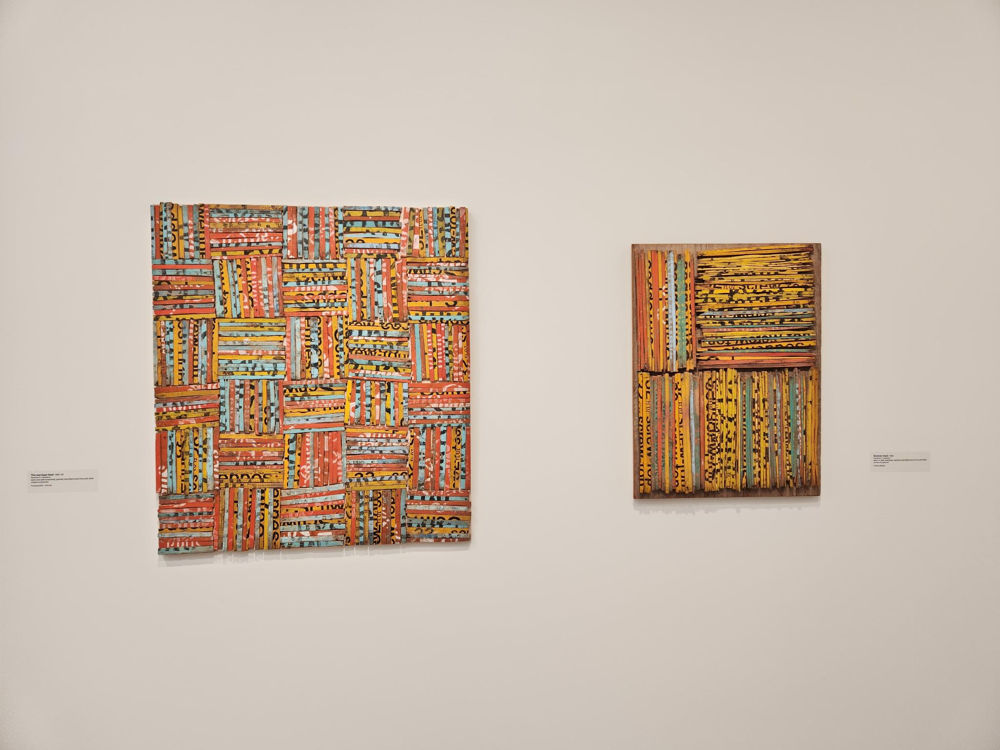
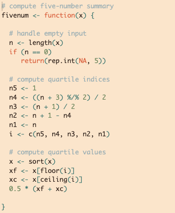

As is becoming the norm for my RStudio theme inspirations, I was inspired by something I saw. This time, it was the works of Rosalie Gascoigne at the National Gallery of Australia.

I took some quick snaps (I'm no art photographer, apologies), to use as a reference image when creating the RStudio theme.



My typical approach is to pop an image into a colour picker tool ([like this](https://imagecolorpicker.com/)), using it to pick out colours I like and get their hex codes. 

```{r}
#| echo: false
scales::show_col(c(
  "#fbe9e1",
  "#6d865a",
  "#c4ac94",
  "#df7f6d",
  "#fce4c9",
  "#37746d",
  "#b58f37",
  "#db5d38",
  "#c4ced9",
  "#273b36",
  "#dc9624",
  "#b04633",
  "#9db0b4",
  "#291c16"
))
```

With these colours in hand, I set to making the theme. This time around, however, it was much easier to produce the theme now that I have an [RStudio theme builder](../../tools/rstudio-themer.qmd) (a tool I've been wanting for some time).

## Rosalie

So here it is, the `rosalie` RStudio theme. Now available from my [`rsthemes`](https://github.com/benharrap/rsthemes) GitHub repo. 



